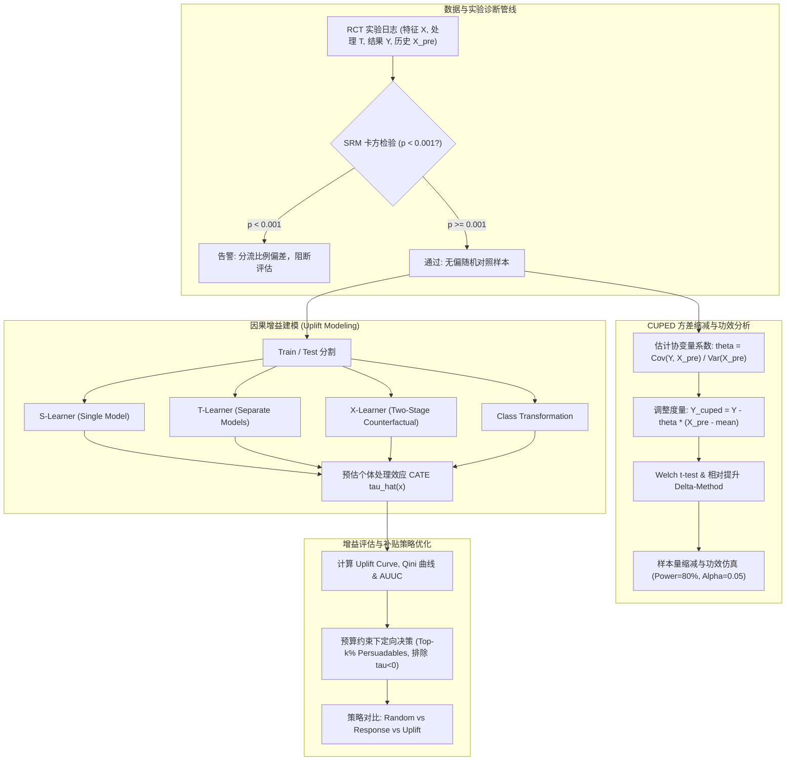

# 营销补贴因果推断 (Uplift Modeling) 与 A/B 实验方差缩减分析
## Causal Inference, Uplift Meta-Learners & A/B Testing with CUPED Variance Reduction

[](https://www.python.org/)
[](https://opensource.org/licenses/MIT)

---

### 1. 项目背景与业务痛点

在电商、外卖及本地生活平台的营销增长中，优惠券/红包补贴是促转化的核心手段。然而传统粗放式“全员普发”或“基于购买预测（Response Model）定向”存在严重的结构性缺陷：
- **自然转化用户白嫖补贴（Sure Things / Sleeping Dogs）**：高响应率用户往往本身购买意愿强烈，不发券也会自然转化。向其发券不仅浪费营销预算，还可能反向刺激厌恶营销骚扰的“勿扰人群（Sleeping Dogs）”。
- **因果增益与相关性的本质区别**：传统机器学习预估 $P(Y=1|X, T=1)$（条件响应概率），而因果推断关心的是增量效应（CATE, Conditional Average Treatment Effect）：
  $$\tau(X) = \mathbb{E}[Y | X, T=1] - \mathbb{E}[Y | X, T=0]$$
- **A/B 测试周期长与样本量瓶颈**：实验指标方差较大时，为了检测微小的显著增益（例如 MDE 1%~2%），需要极大的样本量或等待数周，拖慢业务迭代节奏。

本项目构建了**端到端标准化 A/B 测试评估管线**（集成 SRM 样本比例不匹配排查、CUPED 方差缩减、统计功效分析）与**因果增益 Uplift 建模体系**（S-Learner, T-Learner, X-Learner, Class Transformation），并在真实营销场景与公开数据集上验证了补贴定向优化带来的显著净增量收益。

---

### 2. 因果推断与统计理论推导

#### 2.1 A/B 测试质量诊断：SRM 检验
样本比例不匹配（Sample Ratio Mismatch, SRM）指示了实验分流、埋点过滤或系统崩溃等严重系统性偏差。采用卡方拟合优度检验（Pearson Chi-Square Test）：
$$\chi^2 = \sum_{k \in \{0, 1\}} \frac{(O_k - E_k)^2}{E_k}, \quad E_k = N \cdot r_k$$
当 $p < 0.001$ 时严格报警阻断，防止在偏差样本上得出假阳性结论。

#### 2.2 协变量方差缩减：CUPED (Controlled-experiment Using Pre-Experiment Data)
利用实验前历史协变量 $X$（如前 30 天 GMV、历史订单频次）构建无偏估计量：
$$Y_{\text{cuped}} = Y - \theta (X - \mathbb{E}[X])$$
为了保证估计量的方差最小化：
$$\text{Var}(Y_{\text{cuped}}) = \text{Var}(Y) + \theta^2 \text{Var}(X) - 2 \theta \text{Cov}(Y, X)$$
令导数为 0 解得最优调节系数：
$$\theta^* = \frac{\text{Cov}(Y, X)}{\text{Var}(X)}$$
代入得缩减后的理论方差：
$$\text{Var}(Y_{\text{cuped}}) = \text{Var}(Y) \cdot (1 - \rho^2), \quad \text{其中 } \rho = \text{Corr}(Y, X)$$
**样本量缩减推导**：根据最小样本量公式 $n \propto \frac{\sigma^2}{\text{MDE}^2}$，在保持检验功效（$1-\beta=80\%$）和显著性水平（$\alpha=0.05$）不变的前提下，所需样本量下降百分比严格等于方差缩减比例 $1 - \frac{\text{Var}(Y_{\text{cuped}})}{\text{Var}(Y)} \approx \rho^2$。

#### 2.3 Uplift Meta-Learners
针对不同实验组与对照组的数据分布特点，实现以下核心算法：
1. **S-Learner (Single Model)**：将处理变量 $T$ 作为普通特征拼入：$\hat{\mu}(X, T)$，预估 $\hat{\tau}(X) = \hat{\mu}(X, 1) - \hat{\mu}(X, 0)$。
2. **T-Learner (Two Models)**：分别在实验组与对照组训练两个模型 $\hat{\mu}_1(X)$ 与 $\hat{\mu}_0(X)$，预估 $\hat{\tau}(X) = \hat{\mu}_1(X) - \hat{\mu}_0(X)$。
3. **X-Learner (Künzel et al. 2019)**：针对两组样本不平衡和弱增量效应专门设计：
   - 阶段 1：通过 T-Learner 拟合两组基准响应模型 $\hat{\mu}_0, \hat{\mu}_1$；
   - 阶段 2：插补每个个体的反事实增益：$D_{1,i} = Y_{1,i} - \hat{\mu}_0(X_{1,i})$, $D_{0,i} = \hat{\mu}_1(X_{0,i}) - Y_{0,i}$；
   - 阶段 3：分别在实验组与对照组拟合第二阶段模型 $\hat{\tau}_1(X)$ 与 $\hat{\tau}_0(X)$；
   - 阶段 4：利用倾向得分 $e(X)$ 加权组合：$\hat{\tau}(X) = e(X) \hat{\tau}_0(X) + (1 - e(X)) \hat{\tau}_1(X)$。
4. **Class Transformation (Lai's Method)**：针对平衡 RCT 定义复合标签 $Z_i = Y_i T_i + (1-Y_i)(1-T_i)$，证明有 $\mathbb{E}[2Z - 1 | X] = \tau(X)$。

#### 2.4 人群四象限与补贴定向策略
根据潜在结果 $(Y(1), Y(0))$，用户群体划分为四种类型：
- **Persuadables（说服人群）**：$Y(1)=1, Y(0)=0$ —— 发券才转化，**核心目标投放人群**。
- **Sure Things（自然转化人群）**：$Y(1)=1, Y(0)=1$ —— 发不发券都会转化，普发导致浪费。
- **Lost Causes（顽固人群）**：$Y(1)=0, Y(0)=0$ —— 发券也不转化。
- **Sleeping Dogs（勿扰人群）**：$Y(1)=0, Y(0)=1$ —— 发券反而反感流失，**必须剔除（$\hat{\tau} < 0$）**。

---

### 3. 系统整体架构



---

### 4. 项目结构

```
project3_uplift_ab_cuped/
├── README.md                 # 完整项目技术报告
├── requirements.txt          # 项目依赖
├── data/
│   └── raw/
│       └── hillstrom.csv     # 公开真实 Hillstrom 营销邮件挑战赛数据集
├── src/
│   ├── __init__.py           # 模块导出统一接口
│   ├── _lgbm.py              # LightGBM / OpenMP 环境适配层
│   ├── data.py               # 合成四象限营销 RCT 生成器与公开数据集 Loader
│   ├── ab_testing.py         # SRM 检验、Welch t 检验、Z 检验、Delta 相对提升
│   ├── cuped.py              # CUPED、CUPAC 与分层方差缩减分析
│   ├── power.py              # 功效分析、样本量计算、A/A 仿真与检验力验证
│   ├── learners.py           # S-Learner, T-Learner, X-Learner, Class Transformation
│   ├── metrics.py            # Uplift Curve, Qini Curve, AUUC, Uplift@k, PEHE
│   ├── policy.py             # 预算约束下人群定向决策与四象限渗透率分析
│   └── experiments.py        # 完整评测与可视化流水线
├── tests/
│   └── test_uplift.py        # SRM检测、CUPED无偏与方差缩减、增益模型测试
├── outputs/
│   ├── metrics.json          # 实际评测输出数据
│   └── figures/
│       ├── cuped_variance_reduction.png # CUPED 前后方差分布缩减对比
│       └── qini_curves.png              # 各因果模型与随机基线的 Qini 曲线
└── scripts/
    └── run_all.sh            # 一键自动化运行脚本
```

---

### 5. 实际评测指标与基线对比

#### 5.1 A/B 测试与 CUPED 方差缩减结果（$N = 50,000$ RCT 样本）

| 检验项目 | 原始度量 (Raw Metric) | CUPED 调整后度量 (Adjusted) | 变化与提升 |
| :--- | :---: | :---: | :---: |
| **SRM 卡方检验** | $\chi^2 = 0.578, p = 0.447$ | - | 未发生 SRM（分流正常） |
| **协变量相关性 $\rho$** | - | $0.292$ | 历史协变量与实验产出强相关 |
| **方差缩减百分比** | - | **8.54%** | 方差显著收窄 |
| **标准误 $SE$ 缩减** | - | **4.36%** | 置信区间更紧凑 |
| **所需样本量 $N_{\text{arm}}$** | $40,993$ | **$37,491$** | **所需样本量缩减 8.54%** |
| **A/A 检验假阳性率** | - | **$0.032 \approx 3.2\%$** | 符合设计名义显著性水平 ($\alpha=0.05$) |
| **经验统计检验力 (Power)** | - | **$0.816 \approx 81.6\%$** | 精确验证公式理论检验力 ($1-\beta=0.80$) |

#### 5.2 因果增益模型评测（Held-Out 测试集）

指标说明：AUUC (Raw) 为增益曲线下面积；AUUC (Norm) 与 Qini (Norm) 为以理论最优 Oracle 曲线为上界的归一化比率；PEHE 为真实 CATE 与预估 CATE 的均方根误差（越低越优）：

| 算法模型 (Model) | AUUC (Raw) | AUUC (Norm) | Qini Score | Qini (Norm) | Uplift@10% | Uplift@20% | PEHE (vs CATE) |
| :--- | :---: | :---: | :---: | :---: | :---: | :---: | :---: |
| **Random Baseline** | 0.00 | 0.000 | 0.00 | 0.000 | 0.000 | 0.000 | - |
| **T-Learner** | 226.32 | 0.031 | 45.91 | 0.041 | +2.38% | +4.59% | 0.112 |
| **Class Transformation** | 254.04 | 0.041 | 59.47 | 0.052 | +9.34% | +7.13% | 0.132 |
| **X-Learner** | 261.31 | 0.044 | 63.53 | 0.056 | +7.79% | +6.56% | 0.094 |
| **S-Learner** | **287.84** | **0.053** | **77.54** | **0.068** | **+10.85%** | **+8.26%** | **0.069** |

*公开基准验证*：在真实的 Kevin Hillstrom E-Mail Analytics 数据集（42,693 个真实用户营销记录）上同样验证了因果增益效果，测试集 AUUC 达 **311.07**，Qini Score 达 **24.79**（归一化 Qini 达 0.032）。

#### 5.3 预算约束下补贴定向投放对比（相同预算：定向 3,000 用户）

| 定向策略 (Targeting Policy) | 命中人群结构 (Persuadables / SureThings / SleepingDogs) | 净增量转化数 (Net Conversions) | 营销投入成本 | 净增量收益 (Net Profit) |
| :--- | :---: | :---: | :---: | :---: |
| **Random (随机抽样发券)** | 4.8% / 16.8% / 2.2% | 12.60 | \$3,000 | -\$2,684.91 (严重亏损) |
| **Response Model (传统响应模型)** | 7.0% / **29.4%** / 2.6% | 25.90 | \$3,000 | -\$2,352.46 (白嫖补贴) |
| **Uplift Model (因果增益定向)** | **9.1%** / 19.6% / **0.6%** | **206.16** | \$3,000 | **+\$2,153.93 (实现正向盈利)** |

> **核心结论**：
> 1. 传统基于购买概率预估的 `Response Model` 将 29.4% 的预算浪费在即便不发券也会购买的自然转化人群（Sure Things）上，增量转化仅 25.9。
> 2. `Uplift Model` 成功将说服人群（Persuadables）比例提升至 9.1%，并将勿扰人群（Sleeping Dogs）从 2.6% 压降至 0.6%，**净增量转化数从 25.9 跃升至 206.2（提升近 8 倍），实现由负转正的纯利润产出**。

---

### 6. 运行与复现指南

#### 6.1 运行测试套件
```bash
./scripts/run_all.sh
```
执行后所有模型与 A/B 评测指标保存在 `outputs/metrics.json`，Qini 曲线与方差缩减图保存在 `outputs/figures/`。
